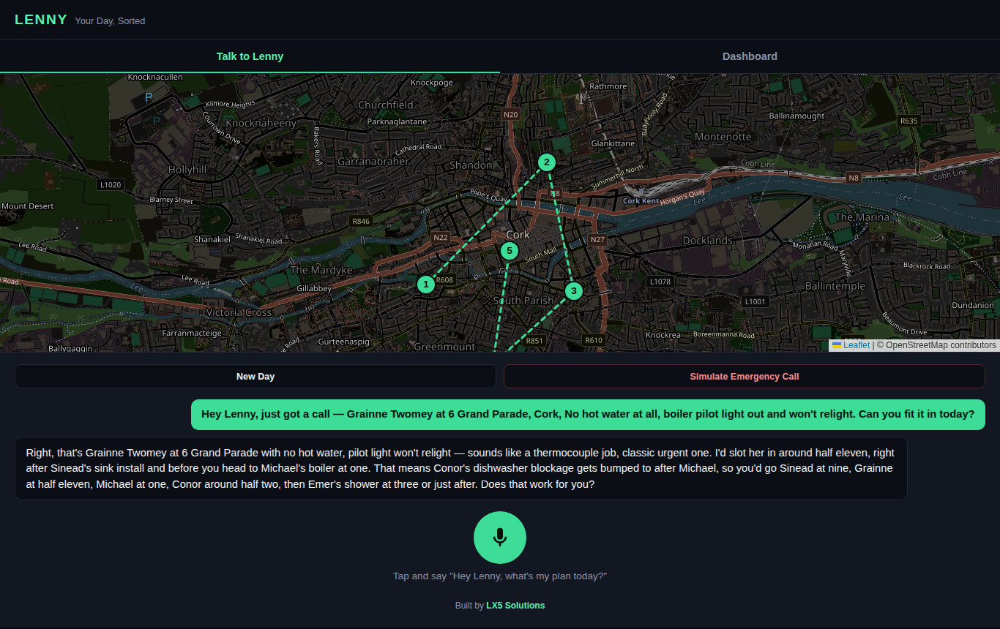
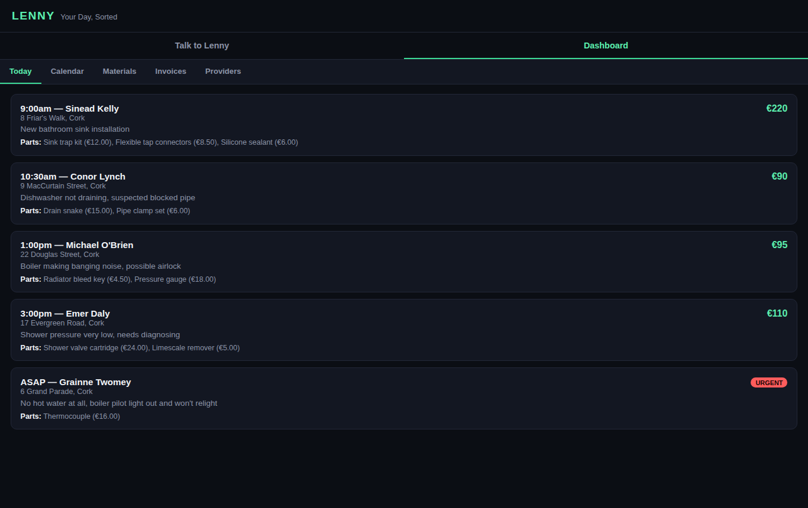
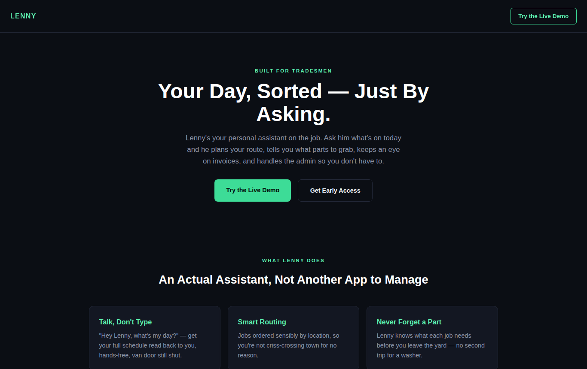

# 🛠️ Lenny: the AI assistant for tradespeople

**"Hey Lenny, what's my day?"** Lenny plans the route, lists the parts for each job, fits in emergency call-outs and keeps track of invoices, all hands-free from the van.

🖱️ **[Try the live demo](https://lenny.lx5solutions.com/demo.html)** (tap "Simulate Emergency Call")

## What it does

- 🎙️ **Talk, don't type.** Voice in, spoken answers out. Built for gloves and van cabs.
- 🗺️ **Smart routing.** Jobs ordered by location, re-planned when an urgent call comes in.
- 🔧 **Never forget a part.** Each job shows the parts and costs before you leave the yard.
- 🚨 **Emergency call-outs.** Tell Lenny about a new urgent job and it slots it in and explains the new plan.
- 💶 **Invoices and suppliers.** Tracks what's owed and where parts come from.

## Under the hood

Node.js + Express backend, Claude for planning and conversation, browser speech recognition and synthesis, Leaflet maps.

> Source code is private. This repository is a product showcase. The demo runs on made-up jobs and customers.

---

Built by **[LX5 Solutions](https://lx5solutions.com)**, custom AI automations for trade businesses.
